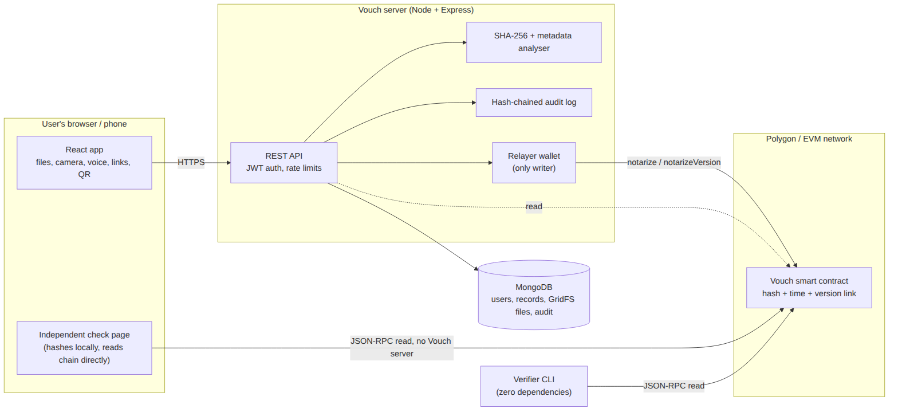
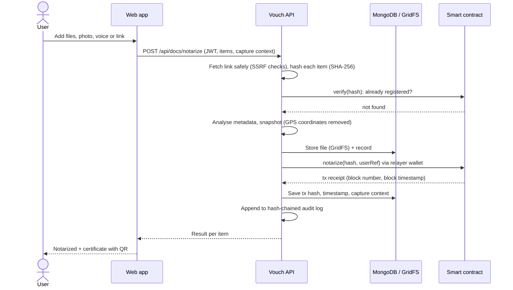
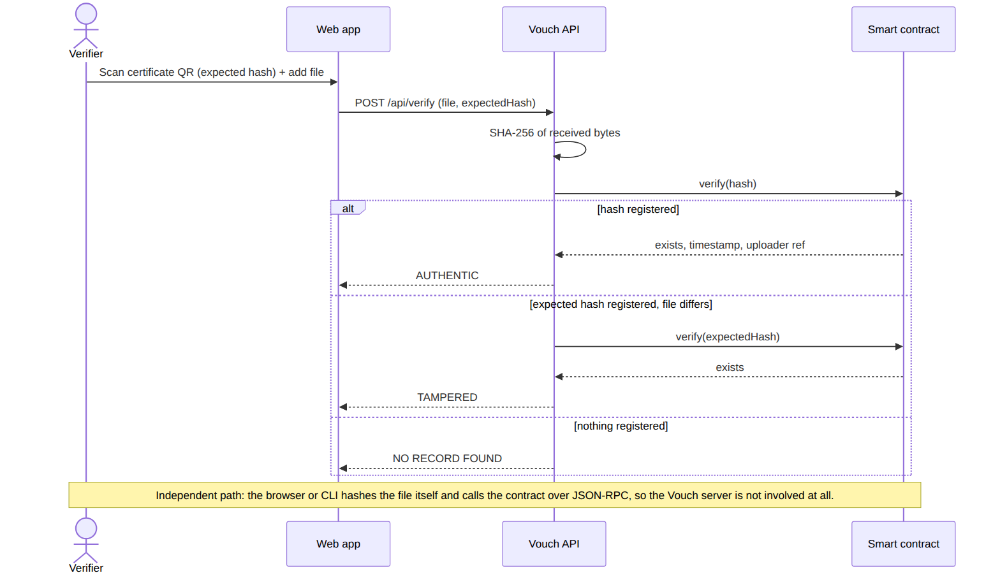
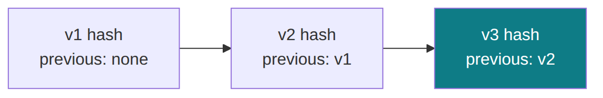
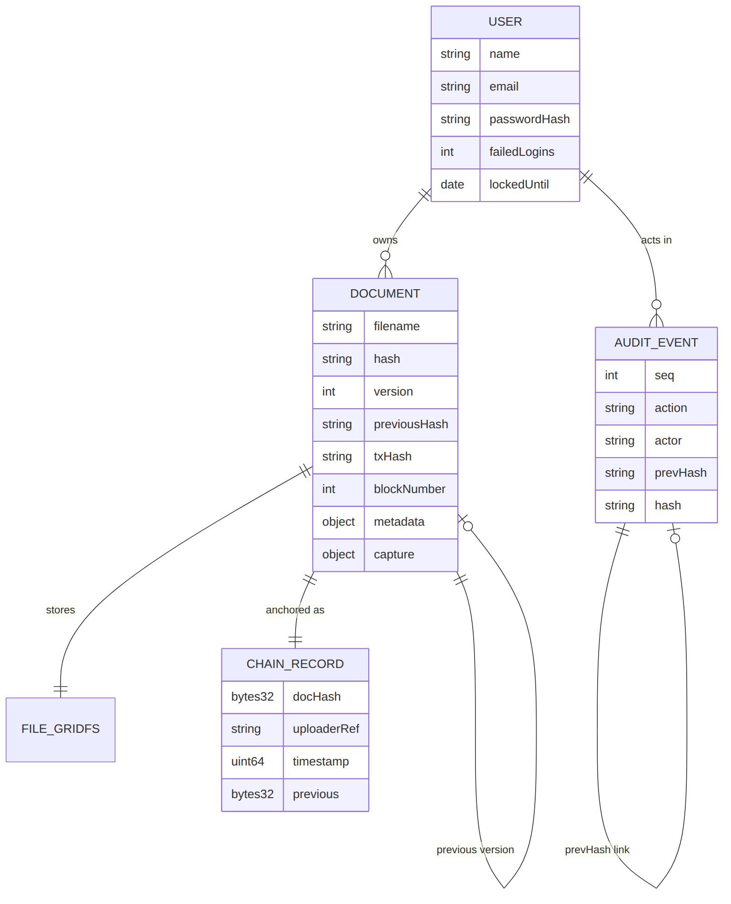
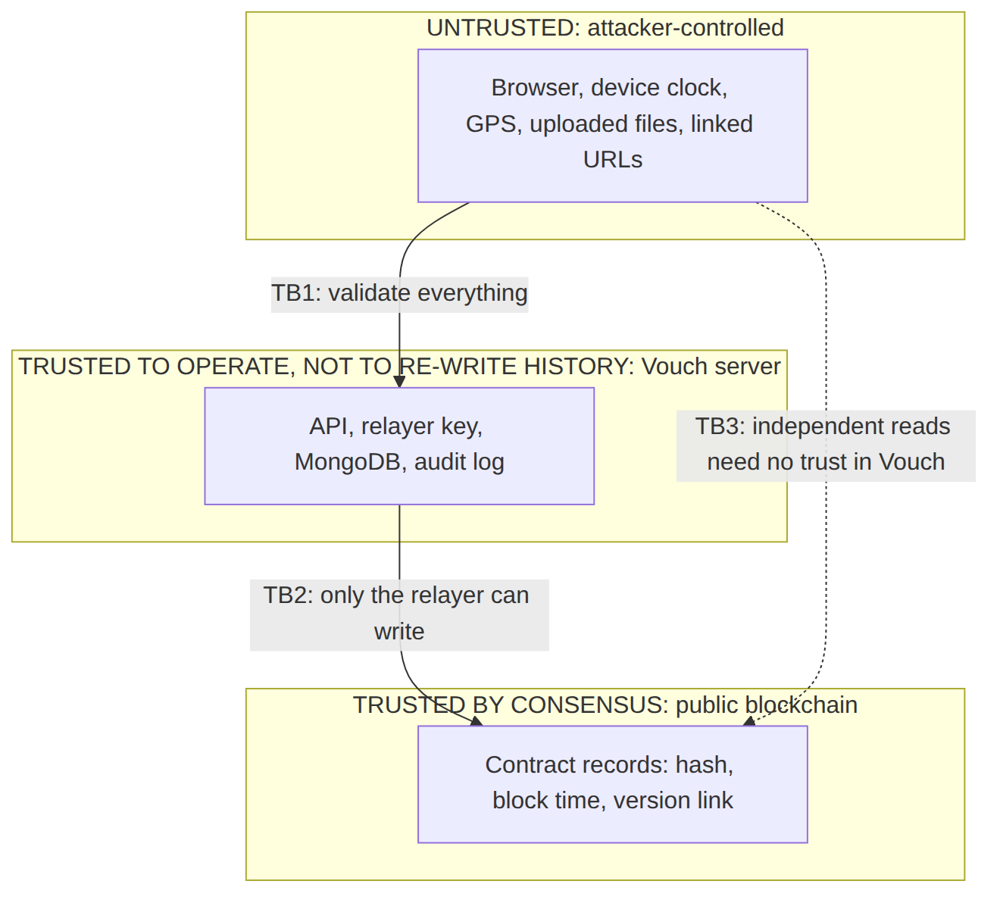

# Vouch Architecture

## Components
| Component | Folder | Responsibility |
|---|---|---|
| Web app | `client/` | React UI: notarize, verify, analyse, independent check. Uses the shared input picker (files, camera, voice, link, QR) |
| API | `server/` | Auth, hashing, metadata analysis, safe link fetching, relayer, certificates, audit log |
| Storage | MongoDB + GridFS | Users, document records, file bytes, audit events |
| Smart contract | `contracts/` | Public registry: hash, block time, uploader reference, previous-version link |
| Independent verifier | `verifier/` | Zero-dependency library and CLI that read the contract directly |

## Notarize flow

Items are processed sequentially because a single relayer wallet must send transactions in nonce order.

## Verify flow

TAMPERED needs the expected hash from a certificate QR; without it a changed file can only be reported as "no record found".

## Versions

Each version points to its predecessor on-chain. The contract refuses a version whose predecessor does not exist, so history only grows forwards.

## Data model

## Trust boundaries

## API summary
| Method and path | Auth | Purpose |
|---|---|---|
| POST `/api/auth/register`, `/login` | no | Accounts (lockout and audit) |
| POST `/api/docs/notarize` | yes | Batch notarize files, captures, links |
| POST `/api/docs/:id/version` | yes | New version of an owned document |
| GET `/api/docs`, `/:id/metadata`, `/:id/download`, `/:id/certificate` | yes | Own records |
| POST `/api/verify` | no | Verify items; optional `expectedHash` for tamper detection |
| GET `/api/verify/:hash`, `/:hash/history` | no | Record lookup and version history |
| POST `/api/metadata/analyze` | no | Metadata analysis (nothing stored) |
| GET `/api/p/:token`, POST `/api/p/:token/check` | share link | Minimal third-party view and "does my copy match?" (never returns a hash) |
| POST/DELETE `/api/docs/:id/share` | yes | Owner sets share level and expiry, regenerates or revokes the link |
| POST `/api/stego/extract` | yes | Download a hidden payload found by the analyser (inert `.dat`) |
| GET `/api/config` | no | Public contract address, RPC and explorer link |
| GET `/api/health` | no | Liveness |

## Key design decisions
- **Hash only on-chain.** Privacy, small constant cost, and nothing to delete later.
- **Relayer wallet.** Users need no crypto wallet; reading is free for everyone.
- **Block timestamp, not server clock.** Time comes from consensus.
- **Two verification paths.** Convenient (server) and trustless (browser or CLI).
- **Indicators, not verdicts** for metadata, because metadata can be forged.
